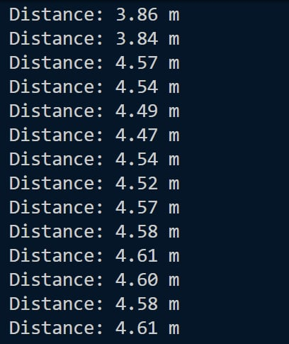

## Cel projektu

Powstanie kilka płytek zawierających moduł UWB (DWM3000) oraz ESP32. Umożliwi to wyznaczenie lokalizacji jednej z płytek względem pozostałych. Projekt uwzględnia również wizualizację pozwalającą testować wykonane płytki.

## Faza pierwsza - projektowanie pcb

Do projektowania płytki wykorzystano oprogramowanie KiCad.
Projekt zawiera moduł DWM3000, mikroprocesor ESP32 oraz 4 diody informujące o stanie systemu.


## Komponenty i funkcje

### Główne elementy

#### 1. DWM3000 (DWM1) - Moduł UWB

- **Producent:** Qorvo
- **Funkcja:** Moduł UWB do lokalizacji i pomiarów odległości
- **Zastosowanie:** Komunikacja bezprzewodowa na krótkich odległościach z pomiarem czasu przylotu
- **Sygnały sterujące:**
  - CLK (Clock) - linia zegarowa SPI
  - MOSI (Master Out Slave In) - linia danych z mikrokontrolera do modułu
  - MISO (Master In Slave Out) - linia danych z modułu do mikrokontrolera
  - IRQ (Interrupt Request) - przerwanie od modułu
- **Piny GPIO do LED:** Moduł posiada dedykowane wyjścia GPIO do sterowania diodami stanu:
  - GPIO0/RXOKLED - wyjście dla LED potwierdzenia odbioru
  - GPIO1/SFDLED - wyjście dla LED Start Frame Delimiter
  - GPIO3/TXLED - wyjście dla LED transmisji

#### 2. XIAO-ESP32-S3 (U1) - Mikroprocesor

- **Producent:** Seeed Studio
- **Model:** XIAO-ESP32-S3
- **Procesor:** ESP32-S3
- **Pamięć:** 8MB Flash, 8MB PSRAM
- **Interfejsy:**
  - SPI: GPIO7 (SCK), GPIO8 (MISO), GPIO9 (MOSI) - sterowanie modułem DWM3000
  - GPIO1-GPIO6 - dostępne dla użytkownika
  - UART: GPIO43 (TX), GPIO44 (RX)
  - I2C: GPIO5 (SDA), GPIO6 (SCL)
- **Funkcja:** Sterowanie modułem DWM3000 i przetwarzanie danych lokalizacyjnych

### Diody LED

Płytka zawiera **4 diody LED**, służące do wizualizacji stanu systemu:

#### 1. **RXOK1 (RX OK LED)**

- **Funkcja:** Informuje o pomyślnym odbiorze pakietu danych
- **Sterownik:** GPIO8/RXOKLED modułu DWM3000
- **Rezystor ograniczający:** R2 (200Ω)
- **Zasilanie:** +3.3V

#### 2. **SFD1 (Start Frame Delimiter LED)**

- **Funkcja:** Sygnalizuje detekcję preambuły (początku ramki danych)
- **Sterownik:** GPIO1/SFDLED modułu DWM3000
- **Rezystor ograniczający:** R3 (200Ω)
- **Zasilanie:** +3.3V

#### 3. **TX1 (Transmit LED)**

- **Funkcja:** Informuje o transmisji danych
- **Sterownik:** GPIO3/TXLED modułu DWM3000
- **Rezystor ograniczający:** R4 (200Ω)
- **Zasilanie:** +3.3V

#### 4. Czwarta dioda LED

- **Funkcja:** Zarezerwowana dla przyszłych rozszerzeń (np. LED zasilania, błędu lub niestandardowego sygnału)
- **Rezystor:** Rezystor ograniczający

### Rezystory

#### Rezystory do LED (200Ω):

- **R2, R3, R4** - Rezystory ograniczające prąd dla diod LED
- **Wartość:** 200Ω
- **Format:** 0805 (SMD)
- **Funkcja:** Ochrona diod LED poprzez ograniczenie prądu do bezpiecznego poziomu

#### Rezystor pull-up (100K):

- **R5** - Rezystor podciągający (pull-up)
- **Wartość:** 100kΩ
- **Format:** 0805 (SMD)
- **Funkcja:** Zabezpieczenie sygnałów logicznych

## Faza druga - przygotowywanie płytek

Zamówiono i przygotowano pięć płytek.


## Faza trzecia - programowanie płytek

Pierwszy prototyp wykorzystywał bibliotekę (Makerfabs)[https://github.com/Makerfabs/Makerfabs-ESP32-UWB-DW3000]

## Opis prototypu

### Architektura systemu

Prototyp składa się z dwóch rodzajów urządzeń pracujących w kooperacji:

1. **TAG** - Urządzenie wysyłające zapytania o dystans
   - Rola: Initiator w protokole SS TWR (Single-Sided Two-Way Ranging)
   - Inicjuje pomiary odległości do zakotwiczonych urządzeń (Anchor)

2. **ANCHOR** - Urządzenie odpowiadające na zapytania
   - Rola: Responder w protokole SS TWR
   - Otrzymuje zapytanie i odsyła odpowiedź z czasami przylotu

### Protokół Two-Way Ranging Distance (TWR)

**TWR** to metoda pomiaru odległości między dwoma urządzeniami UWB oparta na:

- Pomiarze czasu przylotu sygnału (ToA)
- Korekcji błędu zegara między urządzeniami
- Precyzyjnych znacznikach czasu transmisji/odbioru
- Dokładność: 10-15cm na dystansach do 300m

### Double-Sided TWR (DS-TWR)

**DS-TWR** to zaawansowana wersja pomiarów, gdzie oba urządzenia wymieniają się pomiarami:

**Sekwencja:**

1. TAG wysyła Poll → ANCHOR odbiera
2. ANCHOR wysyła Response z czasami → TAG oblicza dystans
3. TAG wysyła Final z czasami TAG → ANCHOR oblicza dystans
4. Wyniki są uśredniane

**Przewagi nad SS-TWR:**

- **Wyższa dokładność** - średniowanie pomiarów z obu kierunków eliminuje błędy asymetryczne
- **Symetria** - obie urządzenia pracują w roli pomiarowej, lepsza kalibracja
- **Mniej artefaktów** - błędy systematyczne się znoszą

**Wady:**

- **Więcej komunikacji** - 4 wiadomości zamiast 2 (większe opóźnienie, więcej energii)
- **Większa złożoność** - synchronizacja dwóch obliczeń
- **Wolniej** - pomiar trwa 2× dłużej

**Przypadki użycia:**

- SS-TWR: Szybkie pomiary jedynego tagu względem wielu zakotwiczonych
- DS-TWR: Precyzyjne sieci gdzie wszystkie urządzenia mogą się nawzajem lokalizować

## Fragmenty kodu

### Fragment 1: Konfiguracja DWM3000

```cpp
static dwt_config_t config = {
    5,               /* Channel 5 (6.5 GHz) */
    DWT_PLEN_128,    /* Preamble length */
    DWT_PAC8,        /* PAC size */
    9, 9,            /* TX/RX preamble codes */
    1,               /* SFD type */
    DWT_BR_6M8,      /* 6.8 Mbps data rate */
    DWT_PHRMODE_STD, /* Standard PHY header */
    DWT_PHRRATE_STD,
    (129 + 8 - 8),   /* SFD timeout */
    DWT_STS_MODE_OFF,
    DWT_STS_LEN_64,
    DWT_PDOA_M0
};

#define TX_ANT_DLY 16395  /* Antenna calibration */
#define RX_ANT_DLY 16395

dwt_initialise(DWT_DW_INIT);
dwt_configure(&config);
dwt_setrxantennadelay(RX_ANT_DLY);
dwt_settxantennadelay(TX_ANT_DLY);
dwt_setrxaftertxdelay(500);  /* Poll→Response delay */
dwt_setrxtimeout(800);       /* Response RX timeout */
```

### Fragment 2: Obliczanie czasu przylotu i dystansu

```cpp
/* Pobierz znaczniki czasu */
poll_tx_ts = dwt_readtxtimestamplo32();
resp_rx_ts = dwt_readrxtimestamplo32();

/* Korekcja błędu zegara */
clockOffsetRatio = ((float)dwt_readclockoffset()) / (uint32_t)(1<<26);

/* Pobierz czasy z odpowiedzi */
resp_msg_get_ts(&rx_buffer[RESP_MSG_POLL_RX_TS_IDX], &poll_rx_ts);
resp_msg_get_ts(&rx_buffer[RESP_MSG_RESP_TX_TS_IDX], &resp_tx_ts);

/* GŁÓWNA FORMUŁA SS TWR */
rtd_init = resp_rx_ts - poll_tx_ts;
rtd_resp = resp_tx_ts - poll_rx_ts;
tof = ((rtd_init - rtd_resp * (1 - clockOffsetRatio)) / 2.0) * DWT_TIME_UNITS;
distance = tof * SPEED_OF_LIGHT;  /* ~0.3 m/ns */

Serial.print("Distance: ");
Serial.print(distance);
Serial.println(" m");
```

**Formuła:** `distance = ((R1 - R2 × clock_correction) / 2) × c`

Gdzie:

- **R1** = czas między wysłaniem Poll a odborem Response
- **R2** = czas między odborem Poll a wysłaniem Response
- **c** = prędkość światła (~0.3 m/ns)
- **clock_correction** = kompensacja błędu zegara

## Parametry konfiguracyjne

| Parametr          | Wartość     | Cel                       |
| ----------------- | ----------- | ------------------------- |
| Kanał             | 5 (6.5 GHz) | Minimalne zakłócenia      |
| Preambuła         | 128 symboli | Balans czułość/szybkość   |
| Szybkość danych   | 6.8 Mbps    | Maksymalna dokładność     |
| Poll→Response     | 500 µs      | Czas przetworzenia Anchor |
| RX Timeout        | 800 µs      | Okno odbioru odpowiedzi   |
| Opóźnienie anteny | 16395       | Kalibracja dla ±10cm      |

## Dokładność systemu

- **Teoretyczna:** 10-15 cm
- **Praktyczna:** 20-30 cm (zależy od kalibracji)
- **Max dystans:** ~300 m (wolna przestrzeń)



### Double-Sided TWR (DS-TWR)

**DS-TWR** to zaawansowana wersja pomiarów, gdzie oba urządzenia wymieniają się pomiarami:

**Sekwencja:**

1. TAG wysyła Poll → ANCHOR odbiera
2. ANCHOR wysyła Response z czasami → TAG oblicza dystans
3. TAG wysyła Final z czasami TAG → ANCHOR oblicza dystans
4. Wyniki są uśredniane

**Przewagi nad SS-TWR:**

- **Wyższa dokładność** - średniowanie pomiarów z obu kierunków eliminuje błędy asymetryczne
- **Symetria** - obie urządzenia pracują w roli pomiarowej, lepsza kalibracja
- **Mniej artefaktów** - błędy systematyczne się znoszą

**Wady:**

- **Więcej komunikacji** - 4 wiadomości zamiast 2 (większe opóźnienie, więcej energii)
- **Większa złożoność** - synchronizacja dwóch obliczeń
- **Wolniej** - pomiar trwa 2× dłużej
