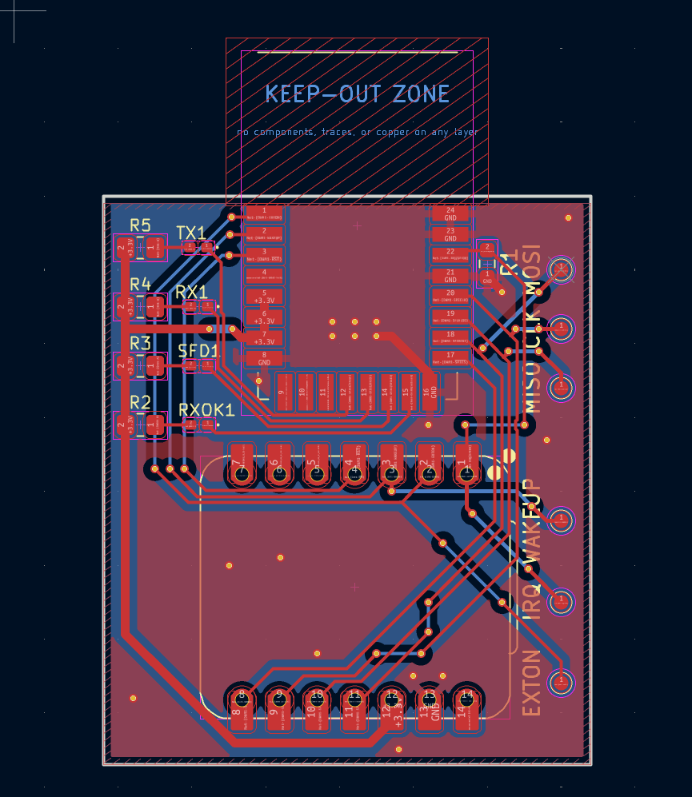

## Cel projektu

Kilka płytek z modułem UWB (DWM3000) i ESP32 do wyznaczenia lokalizacji płytek względem siebie z wizualizacją wyników.

## PCB



### Komponenty

- **DWM3000** – moduł UWB Qorvo
- **XIAO-ESP32-S3** – ESP32-S3
- **LED RXOK/SFD/TX** – sygnalizacja odbioru, preambuły i transmisji sterowana przez DWM3000
- **R2/R3/R4** – rezystory ograniczające prąd LED
- **R5** – pull-up dla sygnałów logicznych

## Architektura — `node.cpp`

Biblioteka: [Makerfabs ESP32-UWB-DW3000](https://github.com/Makerfabs/Makerfabs-ESP32-UWB-DW3000)

Czas jest dzielony na sloty `SLOT_MS = 60 ms`. Każdy moduł wyznacza bieżący slot na podstawie własnego zegara:

```cpp
slot = (millis() / SLOT_MS) % N_NODES;
```

- **W swoim slocie** — moduł inicjuje SS-TWR do każdego innego, potem rozgłasza swój wiersz dystansów (`FUNC_DIST`)
- **Poza swoim slotem** — nasłuchuje, odpowiada na Poll-e od innych i zbiera broadcasty

### Macierz dystansów

Każdy węzeł utrzymuje globalną macierz `dist_matrix[N][N]`:

```cpp
static float dist_matrix[N_NODES][N_NODES];
```

Wpisy są uzupełniane na dwa sposoby:

1. Własne pomiary SS-TWR (`dist_matrix[MY_ID][j]`)
2. Odebrane broadcasty od innych modułów (`FUNC_DIST`) → aktualizują cały wiersz i kolumnę

Moduł 0 drukuje co 200 ms pełną macierz do PC:

```
MATRIX,d01,d02,d03,d12,d13,d23
```

### Kluczowe fragmenty kodu

**Loop — podział na sloty i budowanie macierzy:**

```cpp
int slot = (millis() / SLOT_MS) % N_NODES;

if (slot == MY_ID) {
    for (int j = 0; j < N_NODES; j++) {
        if (j == MY_ID) continue;
        float d = ss_twr_initiate(j);
        if (d > 0.05f && d < 100.0f)
            dist_matrix[MY_ID][j] = dist_matrix[j][MY_ID] = d;
    }
    broadcast_distances(); // rozgłoś swój wiersz macierzy
} else {
    listen_window(slot_rem); // cudzy slot: nasłuch + odpowiedzi
}
```

**SS-TWR — obliczanie dystansu:**

```cpp
uint32_t T1 = dwt_readtxtimestamplo32(); // Poll TX (nasz zegar)
uint32_t T4 = dwt_readrxtimestamplo32(); // Response RX (nasz zegar)
float    ε  = ((float)dwt_readclockoffset()) / (uint32_t)(1 << 26);
memcpy(&T2, &rx_buffer[T2_IDX], 4); // Poll RX (zegar zdalny)
memcpy(&T3, &rx_buffer[T3_IDX], 4); // Response TX (zegar zdalny)

double tof = (((T4-T1) - (T3-T2) * (1.0 - ε)) / 2.0) * DWT_TIME_UNITS;
return (float)(tof * SPEED_OF_LIGHT);
```

`d = ((R1 - R2 × Δclk) / 2) × c` gdzie R1 = round-trip TAG, R2 = round-trip ANCHOR
